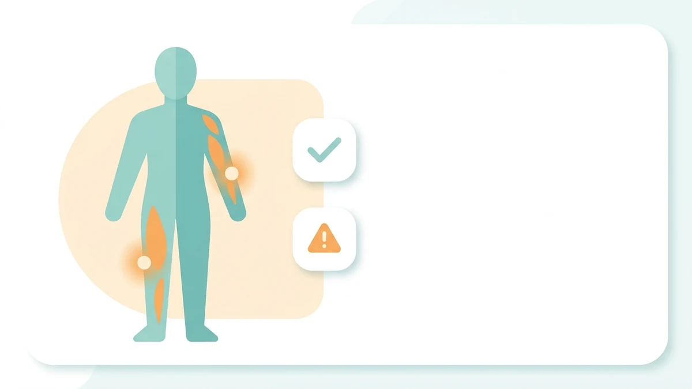
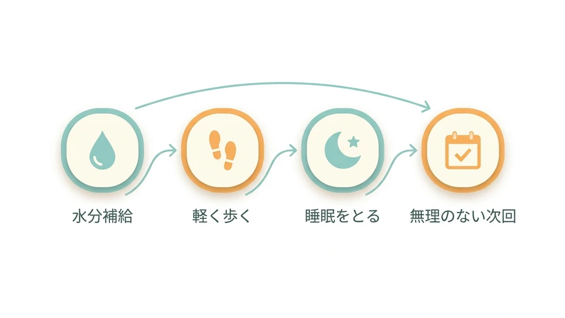

# 筋トレ後の筋肉痛、これって普通？｜初心者が感じやすい"痛み"の見分け方と付き合い方

- **公開日（想定）**: 未公開（下書きのまま）
- **作成日**: 2026-10-13
- **対象**: 水戸・千波でジムに通い始めたばかりの30〜50代
- **WordPress投稿ID**: 5527（**status: draft** を確認済み）
- **投稿編集URL**: https://www.myhealth-24h.com/wp-admin/post.php?post=5527&action=edit
- **スラッグ**: `kinnikutsuu-tsukiaikata-shoshinsha`

## メタディスクリプション

運動を始めたばかりの時期に感じやすい筋肉痛。普通の筋肉痛と注意したい痛みの目安、出たときの過ごし方を、水戸・千波のフィットネスMyhealth24hがご紹介します。

## タグ

ジム初心者 / 筋トレ / ストレッチ / 運動習慣 / 水戸ジム / ジム

（WordPress投稿には既存タグID `[71, 20, 19, 59, 42, 31]` を設定済み）

## 本文（WordPressに投稿済みの内容と同一）

水戸・千波でジム通いを始めたばかりの方から、よくこんな声をお聞きします。「筋トレの翌日、思った以上に筋肉痛がつらい」「筋肉痛が出ないと効果がないのでは」――30〜50代になって久しぶりに体を動かし始めると、こうした"筋肉痛との付き合い方"に戸惑う方は少なくありません。今回は、初めてジムに通う方が感じやすい筋肉痛の疑問と、無理のない過ごし方について、フィットネスMyhealth24h 店長がまとめてみました。

### 運動後の筋肉痛は、よくあることと言われています

トレーニングの1〜2日後に出てくる筋肉痛は、一般的に「遅発性筋肉痛」と呼ばれ、久しぶりに体を動かしたときや、いつもと違う動きをしたときに起こりやすいとされています。特に運動を始めたばかりの時期や、しばらくぶりにジムへ戻ってきたときは、普段使っていなかった部位に筋肉痛を感じやすい傾向があるようです。

「筋肉痛が出ないと効果がないのでは」と気になる方もいらっしゃいますが、筋肉痛の有無だけで運動の成果を判断する必要はないと言われています。体が運動に慣れてくると、同じ内容でも筋肉痛を感じにくくなることもあるようです。あまり気にしすぎず、ご自身の体調と相談しながら続けていくことが大切です。

### 「いつもの筋肉痛」と「ちょっと注意したい痛み」の見分け方

筋肉痛の感じ方には個人差がありますが、一般的には次のような目安が言われています。

- 動かしたときや伸ばしたときに張りや重だるさを感じるが、数日のうちに落ち着いていく
- 左右差が少なく、トレーニングした部位に広く感じる
- 安静にしているときはそれほど気にならない

一方で、次のような場合は無理をせず、早めに医療機関へ相談することをおすすめします。

- 強い痛みが続く、または日に日に悪化していく
- 関節の一点に鋭い痛みがある、腫れや熱感を伴う
- 安静にしていても痛む、しびれを伴う

これらはあくまで一般的な目安であり、医学的な診断に代わるものではありません。気になる痛みがあるときは、自己判断せず専門家にご相談ください。

### 筋肉痛を感じたときの過ごし方

筋肉痛があるときに無理にトレーニングを追い込む必要はないと言われています。次のような過ごし方を意識してみてはいかがでしょうか。

まずは水分補給を意識すること。そして、完全に体を休めるのではなく、軽く歩く程度の活動を取り入れると気分転換にもなります。千波湖の周りは1周が歩きやすい距離なので、筋肉痛で強い運動をしたくない日の軽い散歩コースとしてもおすすめです。あわせて、しっかりとした睡眠をとることも体のコンディションを整えるうえで大切にしたいポイントです。そして何より、痛みが残っているうちは次回のトレーニング強度を少し落とす、部位を変える、休養日を増やすなど、無理のないペースを心がけましょう。

### 次にジムへ行くタイミングに迷ったら

「筋肉痛が残っているけれど、ジムに行ってもいいのか」という疑問もよく聞かれます。痛みの強さや体調には個人差があるため、一律の正解はありませんが、筋肉痛のある部位を避けて別の部位を動かしたり、ウォーキングなどの軽い有酸素運動に切り替えたりする方法もあります。メニューの組み立て方や休む日の決め方について迷ったときは、スタッフにお気軽にご相談いただくか、当ジムの他の記事もあわせてご覧ください。

### まとめ

筋肉痛は運動を始めたばかりの時期に感じやすいものですが、その感じ方や付き合い方は人それぞれです。「普通の筋肉痛」と「注意したい痛み」の違いを知っておくと、安心して運動を続けやすくなります。水戸・千波でジムに通い始めた方も、ご自身の体調に無理のないペースで、楽しく運動習慣を続けていただければと思います。フィットネスMyhealth24h 店長より、皆さまのトレーニングを応援しています。

## 画像

| 用途 | ファイル | サイズ | WordPress media ID | 公開URL |
|---|---|---|---|---|
| アイキャッチ（16:9） | `images/kinnikutsuu-tsukiaikata-eyecatch.webp` | 1200×675px, 13.0KB | 5524 | https://www.myhealth-24h.com/wpv2/wp-content/uploads/2026/10/kinnikutsuu-tsukiaikata-eyecatch.webp |
| 本文用（16:9） | `images/kinnikutsuu-tsukiaikata-flow.webp` | 960×540px, 21.9KB | 5525 | https://www.myhealth-24h.com/wpv2/wp-content/uploads/2026/10/kinnikutsuu-tsukiaikata-flow.webp |

いずれも人物・実在の館内・ロゴ・企業名・具体的な料金・実在の会員やスタッフ・誤解を招く健康効果やビフォーアフターは描いていません。文字はアイコンのラベルとして必要最小限の日本語（本文用画像のみ）を使用しています。

## 公開前チェックリスト

- [ ] 直近投稿（特に2026-10-10公開の「朝活と夜トレ」、2026-09-30公開の「筋トレの順番」記事）との内容重複がないか、公開担当者の目でも再確認する
- [ ] 本文中の「筋肉痛」に関する記述が、医学的な診断・治療・効果の断定になっていないか再確認する（本記事では「〜と言われています」「一般的に」等の表現に留めている）
- [ ] 料金・キャンペーン・スタッフ在中時間・見学日程など変動情報は本文に含めていないため、追加する場合は公式サイト最新情報での確認が必要
- [ ] タイトル・メタディスクリプションの文字数・SEO観点での最終確認
- [ ] アイキャッチ・本文画像の表示崩れがないか、WordPress管理画面のプレビューで確認する
- [ ] カテゴリーの設定（本自動化では未設定。必要に応じて公開担当者が設定する）
- [ ] 公開日時の設定
- [ ] 公開（status を draft → publish）は本自動化では行っていません。人の目で最終確認のうえ、手動で公開してください

## SNS用素材

`social/2026-10-13-kinnikutsuu-tsukiaikata-shoshinsha/` 配下を参照してください。Instagram・X向けの投稿文、SNS用正方形画像を保存しています。**SNSへの自動投稿は行っていません。** 投稿は手動で行ってください。
